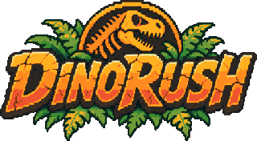
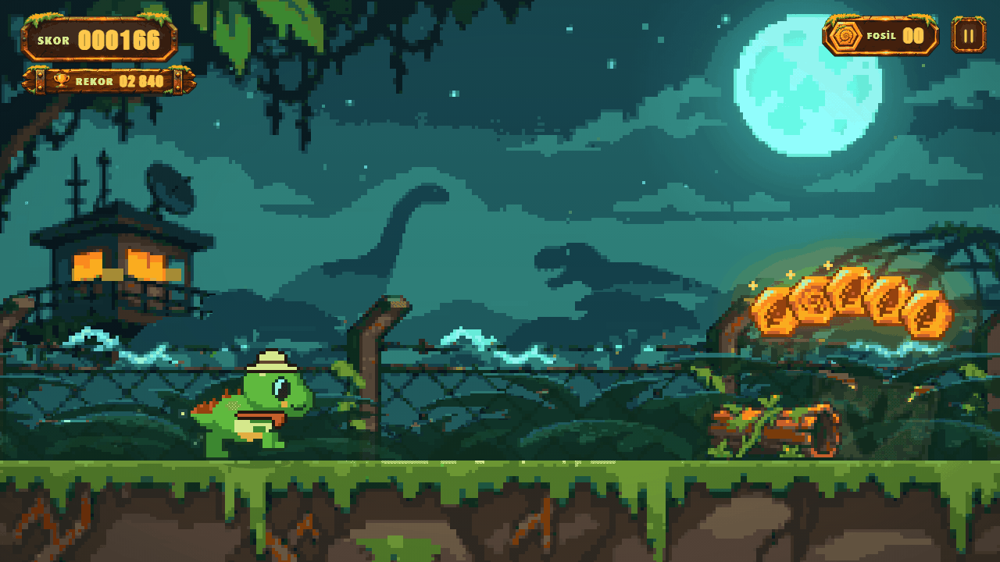
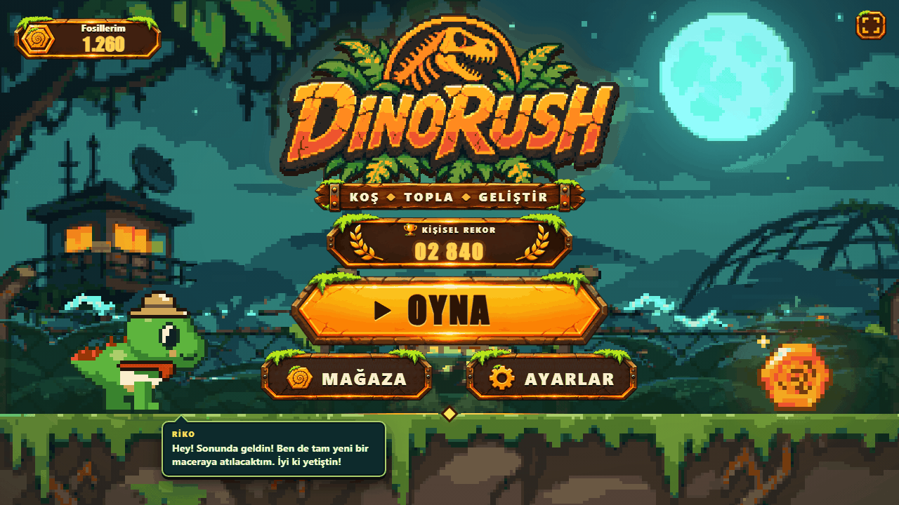
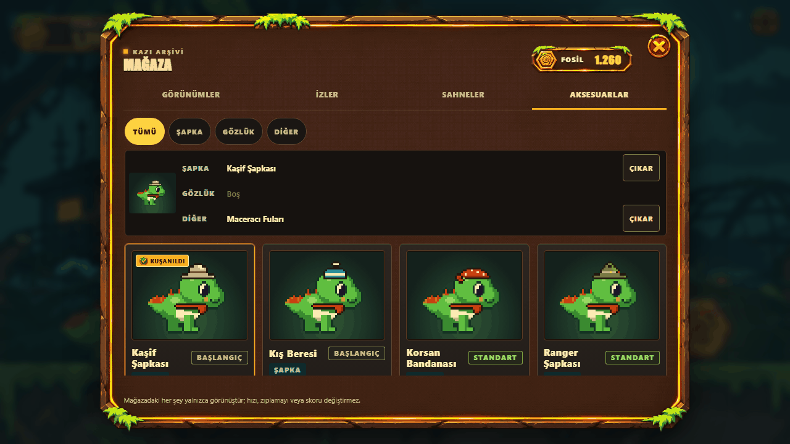
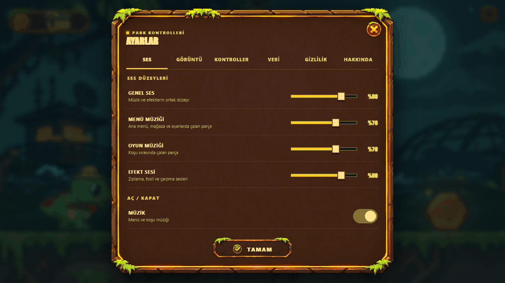
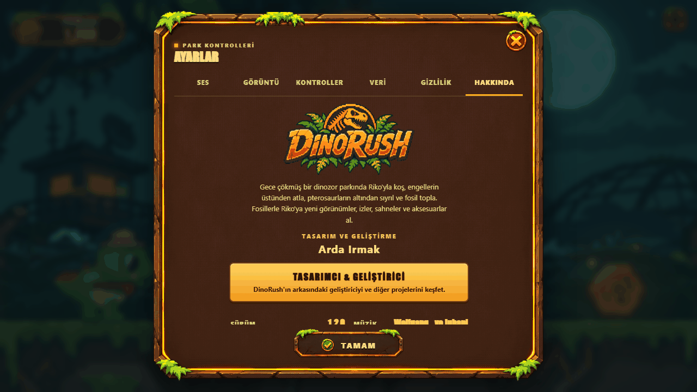
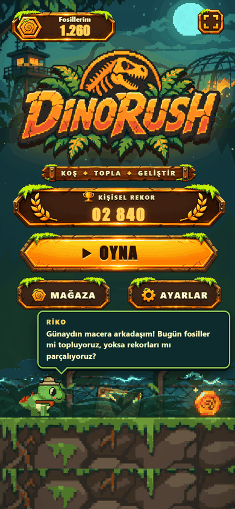
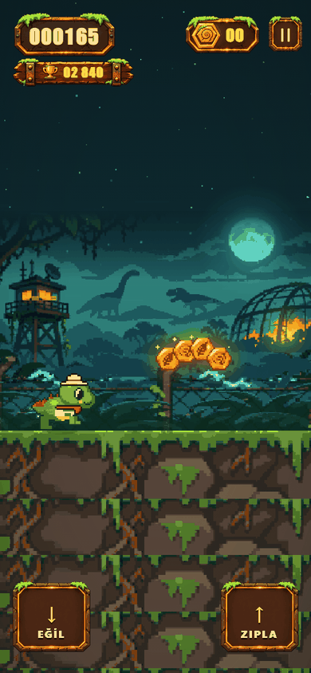
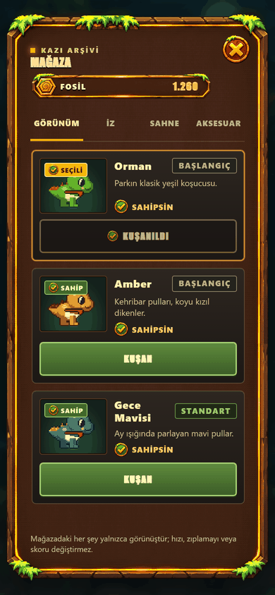
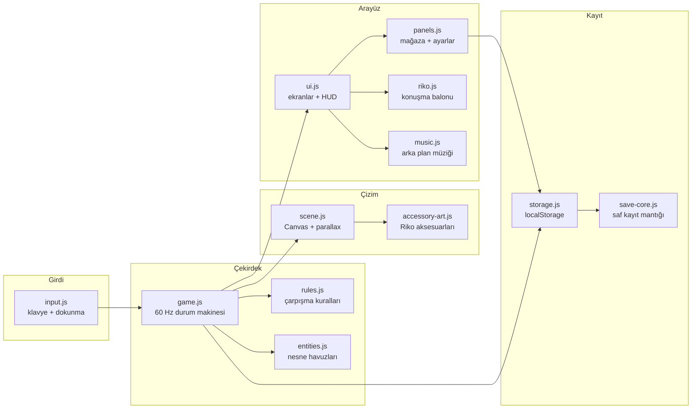

<div align="center">



### Gece çökmüş bir dinozor parkında koş, zıpla, eğil, fosil topla

Tarayıcıda çalışan, özgün piksel sanatlı bir sonsuz koşu oyunu. Kurulum, hesap veya dış kütüphane gerekmez.

[](https://ardairmk55.github.io/DinoRush/)

[](https://github.com/ardairmk55/DinoRush/actions/workflows/pages.yml)
[](LICENSE)


[](https://dinorush.repos.one/)

[Oyna](https://ardairmk55.github.io/DinoRush/) · [Ekran görüntüleri](#ekran-görüntüleri) · [Özellikler](#öne-çıkanlar) · [Geliştirme](#geliştirme) · [Lisans](#lisans-ve-teşekkür)



</div>

---

## İçindekiler

- [Hemen oyna](#hemen-oyna)
- [Ekran görüntüleri](#ekran-görüntüleri)
- [Öne çıkanlar](#öne-çıkanlar)
- [Kontroller](#kontroller)
- [İlerleme ve ödüller](#i̇lerleme-ve-ödüller)
- [Mağaza ve ekonomi](#mağaza-ve-ekonomi)
- [Riko](#riko)
- [Ayarlar](#ayarlar)
- [Mimari](#mimari)
- [Geliştirme](#geliştirme)
- [Yayınlama](#yayınlama)
- [Teknik notlar](#teknik-notlar)
- [Gizlilik](#gizlilik)
- [Katkı](#katkı)
- [Lisans ve teşekkür](#lisans-ve-teşekkür)

## Hemen oyna

| Yol | Nasıl |
|---|---|
| **Tarayıcıda** | [ardairmk55.github.io/DinoRush](https://ardairmk55.github.io/DinoRush/) adresini aç. Telefona "Ana ekrana ekle" ile uygulama gibi kurulabilir; ilk açılıştan sonra çevrimdışı da çalışır. |
| **Yerelde, kurulumsuz** | Depoyu indir, `index.html` dosyasını Chrome, Edge veya Firefox ile çift tıklayarak aç. |
| **Yerel sunucuda** | `python -m http.server` (veya VS Code Live Server) ile aç. Müzik döngüsü ve çevrimdışı önbellek http üzerinde tam çalışır. |

## Ekran görüntüleri

<table>
  <tr>
    <td width="50%"><br><sub><b>Ana menü.</b> Riko oyuncuyu karşılıyor; rekor ve fosil bakiyesi her zaman görünür.</sub></td>
    <td width="50%"><br><sub><b>Aksesuar mağazası.</b> Yuva süzgeci, kuşanılanlar ve nadirlik etiketleri.</sub></td>
  </tr>
  <tr>
    <td width="50%"><br><sub><b>Ayarlar.</b> Ses, görüntü, kontroller, veri, gizlilik ve hakkında.</sub></td>
    <td width="50%"><br><sub><b>Hakkında.</b> Oyun künyesi ve geliştiricinin portföy bağlantısı.</sub></td>
  </tr>
</table>

<div align="center">
  
  
  
  <br><sub>Dikey telefon ekranı: yakın kamera, büyük dokunma alanları, tek sütunlu mağaza.</sub>
</div>

## Öne çıkanlar

| | |
|---|---|
| **Akıcı koşu** | Sabit 60 Hz simülasyon, zıplama tamponu ve "coyote time", basılı tutunca yükselen zıplama, havada hızlı iniş. |
| **Okunur tehlikeler** | Kütük, kaya, çalı ve iki şeritte uçan pterosaur; ilerledikçe çift engel, düşen kaya ve pterosaur kombosu. Gelişleri önceden işaretlenir. |
| **Ustalık ödülleri** | Kıl payı geçişlere ve eksiksiz toplanan fosil kümelerine (zincir) anında bonus fosil. |
| **Uzun vadeli hedefler** | 23 başarım, ayrıntılı istatistikler, günlük seri ödülü ve koşu sonu fosil dökümü. |
| **İlk koşu öğreticisi** | Riko zıplamayı, fosil toplamayı ve eğilmeyi adım adım gösterir; atlanabilir, istenirse tekrar oynanır. |
| **Paylaşım kartı** | Koşu sonunda skor, rekor ve Riko'nun görünümüyle 1200×630 görsel; telefonun paylaş menüsüyle gönderilir. |
| **Riko** | 60 mesajlık, tekrar etmeyen, olaylara göre konuşan kahraman dinozor. |
| **Kozmetik mağaza** | 6 görünüm, 4 iz, 3 sahne ve 17 Riko aksesuarı. Hepsi yalnızca görünüştür, oynanışı değiştirmez. |
| **Ses** | Menü ve koşu için iki CC0 parça (kesintisiz döngü, yumuşak geçiş); kodda üretilen retro ses efektleri. |
| **Her ekranda** | 320 px telefondan 4K masaüstüne uyumlu yerleşim; dikey ekranda yakın kamera ve büyük dokunma düğmeleri. |
| **Erişilebilirlik** | Klavyeyle tam kullanım, görünür odak, ekran okuyucu duyuruları, "animasyonları azalt", performans modu ve renk körlüğü dostu yüksek kontrastlı uyarılar. |
| **Gizlilik** | Hesap, reklam, analitik veya çerez yok. Kayıt yalnızca cihazda tutulur. |
| **Çevrimdışı** | PWA: yayın paketi service worker ile önbelleğe alınır. |
| **Sıfır bağımlılık** | Saf HTML, CSS ve JavaScript. Derleme adımı olmadan çalışır. |

## Kontroller

| Eylem | Klavye | Dokunmatik |
|---|---|---|
| Zıpla (basılı tut: daha yüksek) | `Space` · `↑` · `W` | Oyun alanına dokun veya sağ alttaki **ZIPLA** |
| Eğil (havadaysan hızlı in) | `↓` · `S` | Parmağı aşağı kaydır veya sol alttaki **EĞİL** |
| Duraklat / devam | `P` · `Esc` | Sağ üstteki duraklat düğmesi |
| Tam ekran | — | Sağ üstteki tam ekran düğmesi |
| Çarpışma kutuları (geliştirme) | `H` (yalnız `?debug` ile) | — |

## İlerleme ve ödüller

| Sistem | Nasıl çalışır |
|---|---|
| **Kıl payı** | Bir engelin üstünden çarpışma kutusuyla en fazla 6 birim boşluk bırakarak geçince **+2 fosil**. Yüksek pterosaurun altından normal eğilme sayılmaz. |
| **Zincir** | Bir fosil kümesinin tamamı toplanınca zincir bir kademe artar (en çok x5) ve **seviye × 2 fosil** verir. Tek fosil kaçarsa zincir kopar. |
| **Koşu sonu bonusu** | Her 100 puana +1 fosil, rekor kırınca +25 fosil. Oyun sonu ekranı kazanılan her fosili kalem kalem gösterir. |
| **Günlük seri** | Günün ilk koşusu 10 × seri günü fosil kazandırır (7. günde 70 fosille tavan). Bir gün atlanırsa seri 1'e döner. |
| **Başarımlar** | 23 başarım: skor, fosil, kıl payı, pterosaur, zincir, koşu sayısı, maraton, seri ve aksesuar koleksiyonu. Her biri bir kez açılır ve fosil ödülü verir. |
| **İstatistikler** | Koşu sayısı, ortalama skor, en uzun koşu, kıl payı, zincir, atlatılan pterosaur, zıplama ve en çok yakalayan engel. Menüdeki kupa düğmesinden açılır. |

### Engel desenleri

Oyun ilerledikçe tek engellerin arasına yeni desenler karışır. Hepsi `tests/rules.test.js` içinde kare kare simülasyonla, hem açıldıkları hızda hem tavan hızda geçilebilir olarak doğrulanır.

| Desen | Açıldığı puan | Nasıl geçilir |
|---|---:|---|
| Çift engel (bitişik kütük/kaya) | 600 | Tek, iyi zamanlanmış zıplama (basılı tutmak işi kolaylaştırır) |
| Düşen kaya | 900 | Gölgesi iniş yerini gösterir; indikten sonra zıplanır |
| Pterosaur kombosu (alçak + yüksek) | 1.200 | Önce zıpla, inince eğil |

Koşu sırasında sahip olunan sahneler (Gece, Şafak, Gün Batımı) her 1.000 puanda bir 3 saniyelik yumuşak geçişle değişir. Bu, Ayarlar > Görüntü'den kapatılabilir.

## Mağaza ve ekonomi

Dört kategori vardır. Mağazada satılan hiçbir şey hızı, zıplamayı, çarpışma kutusunu veya skoru etkilemez.

| Kategori | İçerik |
|---|---|
| **Görünümler** | Orman (ücretsiz), Amber, Gece Mavisi, Lavanta, Kızıl, Altın |
| **İzler** | Toz (ücretsiz), Yaprak, Kıvılcım, Ateş Böceği |
| **Sahneler** | Gece (ücretsiz), Şafak, Gün Batımı |
| **Aksesuarlar** | **Şapka:** kaşif şapkası, kış beresi, korsan bandanası, ranger şapkası, yumurta başlık, altın taç<br>**Gözlük:** bilim insanı, güneş, pilot, neon, gece görüş<br>**Diğer:** mini atkı, maceracı fuları, kaşif rozeti, sırt çantası, fosil kolyesi, ranger ekipmanı |

Aksesuarlar üç yuvada toplanır. Her yuvada aynı anda tek aksesuar kuşanılır, farklı yuvalar birlikte kuşanılabilir. Aksesuarlar menüde, koşuda, zıplamada, eğilmede ve düşüşte Riko'yla birlikte hareket eder.

### Nadirlik ve fiyatlar

| Nadirlik | Fiyat (fosil) | Ürünler |
|---|---:|---|
|  | 80–120 | Amber 100 · Yaprak 90 · Kaşif Şapkası 120 · Kış Beresi 100 · Bilim İnsanı Gözlüğü 90 · Mini Atkı 80 · Maceracı Fuları 110 |
|  | 150–250 | Gece Mavisi 200 · Şafak 180 · Korsan Bandanası 180 · Ranger Şapkası 250 · Güneş Gözlüğü 160 · Kaşif Rozeti 150 · Sırt Çantası 220 |
|  | 300–500 | Lavanta 350 · Kıvılcım 300 · Gün Batımı 400 · Pilot Gözlüğü 320 · Fosil Kolyesi 450 |
|  | 600–900 | Kızıl 650 · Ateş Böceği 700 · Yumurta Başlık 800 · Neon Gözlük 650 · Gece Görüş 900 |
|  | 1000–1500 | Altın 1200 · Altın Taç 1400 · Ranger Ekipmanı 1000 |

Bütün katalog **11.150 fosil** tutar. Test botu dakikada yaklaşık 57 fosil toplar (engelsiz, düzenli zıplayarak). Buna göre:

- başlangıç ürünleri 1–2 koşuda alınır;
- efsanevi ürünler yaklaşık 20 koşu ister;
- bütün katalog yaklaşık 3 saatlik koşu gerektirir.

`tests/save.test.js` her fiyatın kendi nadirlik aralığında olduğunu denetler. Satın almadan önce onay penceresi açılır. Hızlı çoklu tıklama tek satın alma yapar; sahip olunan ürün yeniden satın alınamaz.

## Riko

Menüdeki dinozor Riko, oyunun olaylarına göre konuşur. Kendine ait 60 mesajı vardır.

- **Öncelik sırası:** rekor > oyun sonu > başlangıç > fosil > mağaza/ayarlar > tıklama > menü > hareketsizlik. Düşük öncelikli olay, süren mesajı kesmez; mesajlar kuyrukta birikmez.
- **Tekrar önleme:** son 10 mesaj dışlanır; havuz tükenirse son 5, o da tükenirse yalnız son mesaj. Aynı mesaj art arda hiç gelmez.
- **Özel anlar:** ilk ziyarette tanıtım, 3 günden uzun aradan sonra karşılama, seyrek gelen özel mesajlar. Ton, oyuncunun rekoruna göre değişir.
- **Balon:** düğmelerin üstüne binmeyecek yeri seçer ve dokunmayı engellemez. Duraklatınca ve sekme gizlenince kapanır.

Mesajlar `js/riko-messages.js` içindedir. Seçim mantığı `js/riko-core.js` içinde saf fonksiyonlarla yazılmıştır ve `tests/riko.test.js` ile test edilir.

## Ayarlar

| Bölüm | İçerik |
|---|---|
| **Ses** | Genel ses, menü müziği, oyun müziği, efekt sesi; müzik ve tüm sesler için aç/kapat |
| **Görüntü** | Tam ekran, efekt kalitesi, performans modu (1x çözünürlük), parçacık efektleri, ekran sarsıntısı, çarpma flaşı, animasyonları azalt, koşuda sahne geçişi, yüksek kontrastlı uyarılar, tarama çizgileri |
| **Kontroller** | Klavye kartları, dokunmatik şema, öğreticiyi tekrar oyna, titreşim |
| **Veri** | Kayıt durumu ve son kayıt zamanı, özet bilgiler, iki aşamalı sıfırlama (isteğe bağlı tam sıfırlama) |
| **Gizlilik** | Saklanan verilerin gerçek listesi, çerez ve üçüncü taraf bilgisi, KVKK bilgilendirmesi |
| **Hakkında** | Oyun künyesi, sürüm, müzik kaynakları, geliştiricinin portföy bağlantısı |

Mağaza ve ayarlarda başlık, sekmeler ve alt düğme sabit kalır; yalnız içerik alanı kayar.

## Mimari

Kod, tarayıcıda `window.DinoRush` (`DR`) ad alanında bir araya gelen küçük modüllerden oluşur. Kayıt, kurallar ve Riko seçimi gibi saf mantık, DOM'a dokunmayan UMD modülleridir; aynı dosyalar Node testlerinde doğrudan çalışır.



<details>
<summary><b>Proje yapısı</b></summary>

```text
DinoRush/
├── index.html              Semantik menüler, SVG ikonları, HUD ve modallar
├── game.js                 Durum makinesi, sabit 60 Hz simülasyon, skor
├── css/style.css           Tasarım token'ları, PNG çerçeveler, responsive yerleşim
├── js/
│   ├── config.js           Fizik, sprite kareleri, kozmetik kataloğu, müzik
│   ├── scene.js            Canvas çizimi, DPR, parallax, renk derecelendirme
│   ├── accessory-art.js    Riko aksesuarlarının piksel çizimleri
│   ├── input.js            Klavye ve Pointer Events
│   ├── rules.js            Çarpışma ve engel geometrisi (saf)
│   ├── entities.js         Parçacık, engel ve fosil havuzları
│   ├── save-core.js        Kayıt, taşıma ve satın alma mantığı (saf)
│   ├── progress-core.js    İstatistik, başarım, günlük seri, koşu sonu bonusu (saf)
│   ├── share.js            Skor paylaşım kartı
│   ├── storage.js          Güvenli localStorage sarmalayıcısı
│   ├── ui.js · panels.js   Ekranlar, mağaza ve ayarlar
│   ├── riko-*.js · riko.js Riko'nun mesajları, seçim çekirdeği, balon
│   ├── music.js · audio.js Arka plan müziği ve ses efektleri
│   └── ui-skin.js · pwa.js PNG arayüz kaplaması, service worker kaydı
├── assets/                 Sprite sayfaları, arka planlar, arayüz PNG'leri, müzik
├── tests/                  Node birim testleri (kayıt, kurallar, Riko, ilerleme)
│   └── e2e/                Tarayıcı testleri (oyun, özellikler, mağaza, yerleşim, Riko, müzik)
├── tools/                  Yayın paketi, denetim ve varlık üretim betikleri
├── public/                 404, robots.txt, güvenlik başlıkları
└── docs/screenshots/       README görselleri
```

</details>

<details>
<summary><b>Kayıt sistemi</b></summary>

İki `localStorage` anahtarı kullanılır:

| Anahtar | İçerik |
|---|---|
| `dinorush-save-v1` | Rekor, fosil bakiyesi, sahip olunan ve kuşanılan kozmetikler, aksesuarlar, istatistikler, başarımlar, günlük seri, ayarlar, oynama süresi, son kayıt zamanı |
| `dinorush-riko-v1` | Riko'nun son mesajları, ilk ziyaret bilgisi, son görülme zamanı |

- Kayıt sürümü **4**'tür. Eski kayıtlar otomatik taşınır: sahip olunan ürünler, bakiye ve seçimler korunur. Daha önce oynamış oyunculara öğretici gösterilmez.
- v1'deki `lagoon` görünümü Gece Mavisi'ne, v2'deki `musicVolume` iki müzik düzeyine taşınır.
- Bozuk ya da yanlış tipli veri güvenli varsayılanlara döner.
- `localStorage` engelliyse (ör. gizli sekme) oyun bellekte çalışmaya devam eder; Ayarlar > Veri bunu gösterir.

</details>

## Geliştirme

**Gereksinimler:** Node 20+ (testler), Python 3 (yayın paketi). Varlıkları kaynaktan yeniden üretmek için ek olarak Pillow ve numpy gerekir. Oyunun kendisi hiçbir paket istemez.

| Komut | Ne yapar |
|---|---|
| `npm test` | Kayıt, satın alma, aksesuar, ekonomi, ilerleme, çarpışma kuralları ve Riko birim testleri (Node'un yerleşik test koşucusu) |
| `npm run test:e2e` | Headless Chromium ile tarayıcı testleri: oyun akışı, öğretici, kıl payı, zincir, desenler, oyun sonu, profil, paylaşım, mağaza/ayarlar, 10 çözünürlükte yerleşim, Riko ve müzik. Önce `npm ci` ve `npx playwright-core install chromium` gerekir. |
| `npm run audit` | Statik denetim: eksik dosya, yinelenen kimlik, adsız düğme, alt metni eksik görsel |
| `npm run build` | `dist/` yayın paketini ve sürümlenmiş service worker'ı üretir |
| `python tools/make_dino_variants.py` | Görünüm sprite sayfalarını renk eşlemesiyle yeniden üretir |
| `python tools/make_ui_assets.py` | Arayüz PNG çerçevelerini kaynaklardan işler ve 9 parçalı kesim değerlerini ölçer |

Her `main` yüklemesinde GitHub Actions birim testlerini çalıştırır, geçerse paketi GitHub Pages'e yayınlar. Tarayıcı testleri ayrı bir işte, yayından bağımsız çalışır; başarısız olursa ekran görüntüleri indirilebilir.

## Yayınlama

```bash
npm run build
```

`dist/` klasörü herhangi bir statik barındırmaya (GitHub Pages, Netlify, Cloudflare Pages, kendi sunucun) olduğu gibi yüklenebilir. Pakette yalnız çalışma zamanında gereken dosyalar, `404.html`, `robots.txt`, web uygulaması manifesti, güvenlik başlıkları (`_headers`) ve içerik özetiyle sürümlenmiş `sw.js` bulunur.

<details>
<summary><b>Yayın ayrıntıları</b></summary>

- Yeni sürümde `js/config.js` içindeki `version` değerini artırıp paketi yeniden üret. Önbellek adı içerik özetine bağlı olduğu için oyuncular bir sonraki açılışta yeni sürümü alır.
- Müzik service worker kurulumunda indirilmez; ilk çalındığında önbelleğe alınır, sonra çevrimdışı da çalar.
- `_headers` (CSP ve önbellek başlıkları) Netlify ve Cloudflare Pages'te otomatik uygulanır; GitHub Pages bu dosyayı yok sayar.
- Önyüklemede bir betik eksik ya da boş gelirse oyun bozuk açılmaz; Türkçe açıklama ve "YENİDEN YÜKLE" düğmesi gösterilir.
- **GitHub Pages kurulumu:** depoda *Settings → Pages → Source: GitHub Actions* seç. `.github/workflows/pages.yml` gerisini yapar.

</details>

## Teknik notlar

<details>
<summary><b>Dikey (mobil) ekran</b></summary>

Dikey ekranda görünür dünya 640 yerine 440 birimdir ve çizim 76 birim sola kayar. Böylece dino yaklaşık 1,45 kat büyük görünür ve önündeki alan genişler. Bu yalnız görüntüdür: fizik, çarpışma ve engel aralıkları değişmez. Zemin dokunma düğmelerine yer açmak için yukarı alınır; dokunmatik cihazlarda tuval yoğunluğu 2x ile sınırlanır.

</details>

<details>
<summary><b>Pterosaur</b></summary>

- **Alçak şerit:** yere yakın uçar; zıplayarak geçilir.
- **Yüksek şerit:** baş hizasında uçar; eğilerek altından geçilir.
- İlk 120 puanda pterosaur çıkmaz, yüksek şerit 300 puandan sonra gelir.
- Ekrana girmeden önce geleceği yükseklikte uyarı işareti yanıp söner.
- Kurallar `js/rules.js` içindedir ve `tests/rules.test.js` ile kare kare simüle edilerek doğrulanır.

</details>

<details>
<summary><b>Sprite, aksesuar ve çarpışma kutuları</b></summary>

- Dinozor 44×36 hücreli, beş animasyon satırlı (bekleme, koşu, zıplama, eğilme, düşüş) bir sprite sayfasıdır. Görünümler aynı geometride renk varyantlarıdır.
- Aksesuarlar `js/accessory-art.js` içinde sprite pikseli cinsinden çizilir. Her karede ibik noktası ölçülmüştür; aksesuar bu noktaya bağlanır. Çizimler bir kez küçük tuvallere işlenir, sonra tam sayı ölçekle çizilir.
- `DINO_PIXEL_WORLD` 2'dir. Ayakta hitbox kaynak pikselinde `{x:11,y:6,w:25,h:29}`, eğilmede `{x:9,y:17,w:30,h:18}`. Engel hitbox'ları sprite sınırlarından yüzde 12 içeri alınır.
- Çalışma zamanında görsel piksel okuması yapılmaz; oyun `file://` altında da tam çalışır.

</details>

<details>
<summary><b>Ses efektleri</b></summary>

`js/audio.js` efektleri dış dosya kullanmadan kodda üretir (sfxr tarzı sentez: kare, testere, üçgen, sinüs ve gürültü dalgaları, frekans kayması, arpej, alçak geçiren süzgeç). Her ses ilk çalındığında bir kez `AudioBuffer`'a işlenir ve önbellekten çalınır; oyun döngüsünde ses hesabı yapılmaz. Zıplama, fosil (zincir seviyesiyle yükselen perde), zincir, kıl payı, çarpma, düşen kaya, rekor, başarım, seri, geri sayım ve arayüz sesleri vardır.

</details>

<details>
<summary><b>Arka plan müziği</b></summary>

- http(s) üzerinde Web Audio ile çalınır. Döngü noktaları, gerçek içerik uzunluğu ve MP3 gecikmesiyle (1105 örnek) örnek düzeyinde kesindir. `file://` ile açılınca `<audio>` öğesine düşülür.
- Geçişte çalan parça 0,45 sn'de kısılır, yenisi 0,7 sn'de açılır; iki parça hiçbir an üst üste çalmaz.
- İlk dokunuş ya da tuş basışından önce hiçbir şey çalmaz ve dosya indirilmez.
- Kaynaklar ve işleme notları: [`assets/audio/CREDITS.md`](assets/audio/CREDITS.md).

</details>

<details>
<summary><b>Arayüz PNG çerçeveleri</b></summary>

`tools/make_ui_assets.py` kaynak çerçeveleri işler: magenta zemini alfaya çevirir, 9 parçalı kesim değerlerini ölçer, 256 renge sıkıştırır ve sonuçları `assets/ui/`, `js/config.js` ve `css/style.css` içine yazar. `js/ui-skin.js` her PNG'yi ayrı yükler. Bir PNG yüklenemezse o bileşen CSS görünümünde kalır; geometri iki modda aynıdır, yerleşim kaymaz.

</details>

## Gizlilik

DinoRush hesap, reklam, analitik veya çerez kullanmaz. Oyunun kodu kayıtları hiçbir sunucuya göndermez; ilerleme yalnızca cihazdaki tarayıcıda saklanır. Ayrıntılı bilgilendirme ve KVKK notu oyunun içinde, **Ayarlar > Gizlilik** bölümündedir. Bu metin bilgilendirme amaçlıdır, hukuki uygunluk garantisi değildir.

## Katkı

Hata bildirimleri ve öneriler için [Issues](https://github.com/ardairmk55/DinoRush/issues) sekmesini kullanabilirsin. Kod gönderirken:

1. Depoyu çatalla (fork) ve yeni bir dal aç.
2. Değişikliğini yap; `npm test` ve `npm run audit` temiz geçmeli.
3. Mevcut düzeni koru: oyun mekaniği ile görünüm ayrı kalsın, kozmetikler oynanışı etkilemesin, yeni dış bağımlılık eklenmesin.
4. Çekme isteği (pull request) aç ve değişikliği kısaca anlat.

## Lisans ve teşekkür

Kaynak kod [MIT Lisansı](LICENSE) ile yayınlanır.

| İçerik | Kaynak | Lisans |
|---|---|---|
| Menü müziği: *8-bit Forest Theme* | Wolfgang_ · [OpenGameArt](https://opengameart.org/content/8-bit-forest-theme) | CC0 1.0 |
| Koşu müziği: *Level 1* (Retro Game Music Pack) | Juhani Junkala · [OpenGameArt](https://opengameart.org/content/5-chiptunes-action) | CC0 1.0 |

---

<div align="center">

**Tasarım ve geliştirme: Arda Irmak**

[](https://ardaportfoy.vercel.app/)

<sub>© 2026 Arda Irmak · DinoRush</sub>

</div>
